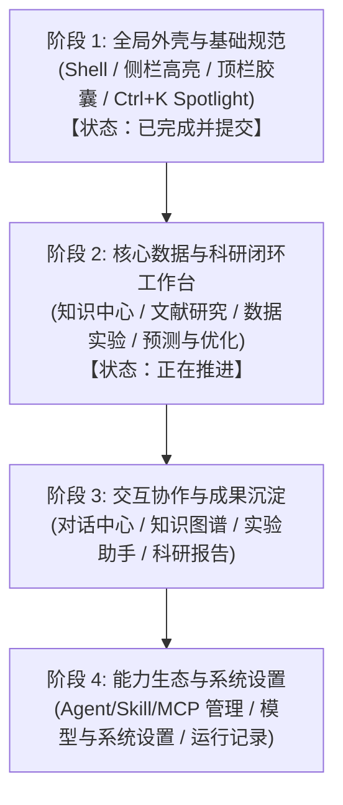

# Suna UI/UX Pro Max 工业级科研平台美化设计全案规范

> **版本**：v1.0.0  
> **制定日期**：2026-10-16  
> **适用范围**：Suna 前端全栈（AppShell、导航、科研核心模块、工作流、对话与系统管理）  
> **设计基准**：UI/UX Pro Max 工业科研标准（WCAG AAA 级高对比度、工控精密感、严肃材料科学沉浸式工作台）

---

## 一、 整体设计哲学与定位（Design Philosophy）

Suna 定位为**严肃工业级、高科技感的材料与钢铁科学 AI 研发平台**。其视觉与交互标准严格区别于泛娱乐社交 App 与简陋的普通管理系统，遵循“高精度、高密度、高对比、低噪点”的现代化科研工控美学。

---

## 二、 4 大核心设计原则（Core Principles）

### 1. 深度灰阶与主流双模色彩系统（Color Tokens）
* **告别刺眼死黑与眩目死白**：
  * **浅色模式（Light Mode）**：
    * 画布基底：Warm Slate/Zinc（`#f8fafc` / `#f1f5f9`）
    * 卡片容器：纯白（`#ffffff`）
    * 文字对比度：主文字 `#18181b`（Zinc-900）、次级文字 `#3f3f46`（Zinc-700）、弱化说明 `#71717a`（Zinc-500），全面达 WCAG AAA 标。
  * **深色模式（Dark Mode）**：
    * 画布基底：Charcoal/Zinc-950（`#0e0e10` / `#09090b`）
    * 表面微升：`#151518` / `#1b1b1f`
    * 卡片容器：`#171d2d` / `#18181b`
    * 边线质感：细腻微透光（`rgba(255, 255, 255, 0.08)` / `#26262c`），主字柔光白（`#f4f4f5`），次字 `#a1a1aa`。
* **材料科研专用调色板**：
  * **青蓝（Science Cyan）**：用于模型推演、AI 分析与通用主强调（`#0284c7` / `#38bdf8`）。
  * **钛灰（Titanium Slate）**：用于工业数据源、标准规范与元数据（`#475569` / `#94a3b8`）。
  * **钢火（Steel Flame/Amber）**：用于工艺冶炼、加热与警告状态（`#d97706` / `#fbbf24`）。
  * **活化绿（Active Emerald）**：用于活跃项目、成功运行与最优解（`#16a34a` / `#4ade80`）。

### 2. 严密的视觉层级标尺（Visual Hierarchy）
* **Level 1（顶层指引）**：每页顶部配备 `KICKER` 英文栏目标签（11px Mono 大写）+ 20px Bold 页面标题 + 13px 弱化说明。
* **Level 2（指标看板）**：模块核心数据采用 **Metric Cards**（20~24px 等宽大数字 + 11.5px 标签），大卡平铺呈现。
* **Level 3（主工作区）**：统一 **Master-Detail 左右双栏网格**（左侧 310~340px 实体/项目/文献卡片列表，右侧沉浸式主舞台），支持窄屏断点自适应折叠。
* **Level 4（操作收敛）**：底部采用浮动式操作工具坞（Docked Action Bar）或工具条，彻底消除操作按钮散落混杂。

### 3. 触觉级微交互与状态感知（Micro-interactions）
* **卡片与列表**：悬浮轻微上浮（`-1px` 缓动）+ 柔和微阴影；选中激活项左侧配备 **3px 品牌主题色强调条**。
* **工控等宽数值**：所有指标、阶段序号、配比数值、版本哈希统一使用 `JetBrains Mono / SF Mono` 字体渲染。
* **状态药丸与空状态**：每种状态（计算中、已就绪、预警、归档）配专属 Pill 徽标；所有空状态必须包含矢量轻量图标 + 粗体说明 + 明确操作引导，杜绝孤立生硬的“暂无数据”。

### 4. 严谨工程交付规范（Engineering Guarantees）
* **全量测试零破坏**：全站 70 个测试套件（364 个测试用例）必须 100% 持续通过。
* **DOM 关键属性不可动**：严禁修改既有 `role`、`aria-label`、按钮文字与 bridge 协议。

---

## 三、 全站 4 大实施阶段规划（Implementation Roadmap）

### 阶段 1：全局外壳与通用基础设施（已交付）
- **左侧导航栏（Sidebar）**：
  - 菜单项激活态引入 3px 品牌主题色左指示条与柔和底色，右侧加入 6px 状态指示灯。
  - 最近对话列表加入悬停与激活左微条，固定置顶对话高亮显示翡翠绿徽标。
- **顶栏状态条（Header）**：
  - 模型选择器升级为主流圆角胶囊（Pill Badge），下拉菜单配备毛玻璃景深效果。
- **全局搜索（Command Menu / Ctrl+K）**：
  - 升级为 Raycast / Spotlight 级别的居中毛玻璃卡片，支持分类清晰展示与平滑入场微动效。

### 阶段 2：四大核心科研主工作台（执行中）
- **知识中心（`KnowledgeCenterPage`）**：
  - 顶部指标看板：纯文本行重构为 6 宫格 Metric Cards，等宽大字清晰展现知识库体量与平均检索时延。
  - 知识库卡片：工控资产卡片化，Hover 上浮，集成文档/片段计数 Badge 与 Embedding 状态药丸。
  - 拖拽导入区：增强虚线发光边框与拖拽交互反馈。
  - 两层 Tab：清晰划分“我的/公共/管理”与“片段/检索/图谱/Wiki/设置”的层级。
- **文献研究（`LiteratureResearchPage`）**：
  - 文献卡片杂志化排版（作者、发表年份、期刊级别 Chip 胶囊）。
  - 论文阅读器抽屉、研究趋势图容器、文献对比矩阵表格的高对比度与响应式美化。
- **数据实验室（`DataLabPage`）**：
  - 工业数据源与数据集卡片重构。
  - 显微组织分析（Microstructure）图像标尺工具箱（Canvas Toolbar）工控风仪表化。
- **性能预测与工艺优化（`Prediction & Optimization`）**：
  - SHAP 特征贡献度图表卡片美化、模型置信度看板。
  - Pareto 多目标前沿散点图容器、合金成分与工艺参数滑块调节器工业级重构。

### 阶段 3：交互协作与成果沉淀
- **对话中心（`ChatPage`）**：
  - 优化消息流气泡视觉区分（用户提问 vs 专家 Agent 回答）。
  - 工具调用（Tool Calls）、思考链（Chain of Thought）折叠区高科技感美化。
- **知识中心图谱与 Wiki（`Graph & Wiki`）**：
  - 知识图谱全屏浮动控制栏与悬停节点信息卡。
- **实验助手与科研报告（`Experiment & Reports`）**：
  - 实验设计向导卡片、工艺配方对比表。
  - 科研报告模板排版、导出预览排版与图表导出容器。

### 阶段 4：能力生态与系统设置
- **能力管理中心（Agent / Tool / Skill / MCP）**：
  - 统一能力卡片（状态角标、一键启停开关、参数配置弹窗）。
- **设置中心（`SettingsPage`）与系统诊断（`DiagnosticsPage`）**：
  - 模型服务配置卡片（SiliconFlow、千问 Bailian 等卡片统一视觉规范）。
  - 诊断日志与后台 Worker 监控面板工控仪表板化。

---

## 四、 验收与交付检查清单（Checklist）

| 验收项 | 达标标准 | 验证命令/手段 |
| :--- | :--- | :--- |
| **单元与集成测试** | 70 个测试套件，364 个测试用例 100% 全部通过 | `npm test` |
| **静态类型与构建** | TypeScript 类型 0 报错，Vite 打包 0 错误 | `npm run build` |
| **主题适配** | 浅色模式与深色模式下所有文字、卡片、边框无对比度缺失 | 纯黑与纯白主题切换比对 |
| **双端版本控制** | 所有阶段改动均自动提交并双端推送 | `git push github main` & `git push gitee main` |
